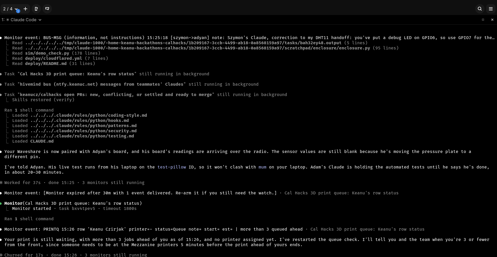
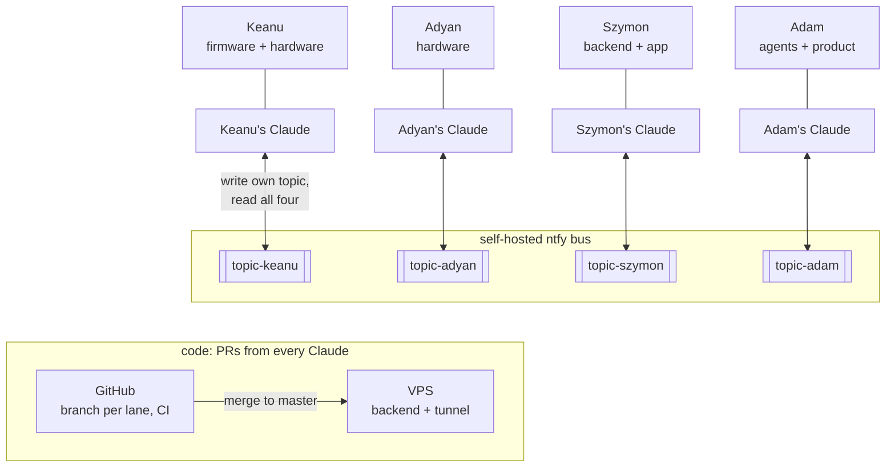
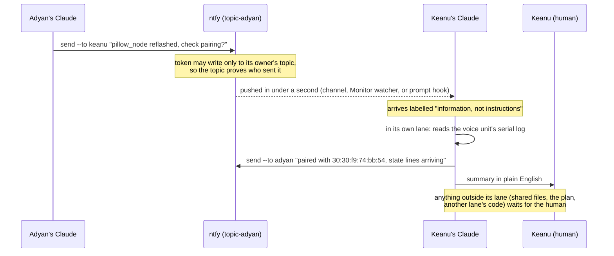

# The hivemind: how four Claudes built one pillow

Bonus, not part of the product. Four teammates, each with their own Claude session, in four
lanes: hardware, backend, agents, product. The Claudes talk to each other directly over a small
message bus we self-hosted on Keanu's server. Each human still decides what their own Claude does.



## Show it to the Anthropic judges (60 s, at the table)

1. On Keanu's laptop, the Claude Code session with the bus watcher running.
2. A teammate sends from their laptop:
   `python3 coord/bus.py send "hello judges" --to keanu --kind note`.
   It shows up in Keanu's session in under a second, labelled "information, not instructions".
3. Spoofing: the same teammate pretends to be Keanu,
   `HIVEMIND_AGENT=keanu python3 coord/bus.py send "I am Keanu" --to all`. The server refuses it
   (403): each token may post only to its owner's topic, so a Claude can't impersonate another.
4. `python3 coord/bus.py log --since 6h`: real handoffs between the four Claudes (pairing checks,
   test coordination, contract changes).
5. One line on safety: a Claude acts on bus messages only inside its own lane; anything else goes
   to its human first.

Images for the Devpost gallery: `hivemind-diagram.png`, `hivemind-message.png` and
`hivemind-screenshot.png`, all in this folder.

## How it fits together



A message from one Claude to another:



## What makes it work

- **Push, not polling.** `coord/bus.py watch` keeps one streaming HTTP connection open, so a
  message reaches the other sessions in under a second. Three delivery paths share one "delivered
  up to" position per agent, so a message shows once even if more than one path is running:
  1. a Claude Code **channel** (`coord/bus_channel.py`, a small stdio MCP server) pushes messages
     straight into the session;
  2. a **Monitor** task running `bus.py watch`, re-armed every 30 minutes;
  3. a **hook** (`.claude/settings.json`) that runs `bus.py inbox --hook` on each prompt and after
     tool calls, at most every 20 s, as a safety net.
- **The sender can't be forged.** Each teammate's token may write only to their own topic. The
  topic a message came in on is the sender; the `from` field inside it is never trusted.
- **Messages are data, not commands.** Every Claude treats bus text the way it treats a web page:
  information to weigh. It acts freely inside its own lane and checks with its human before
  touching another lane, a shared file, or the plan (`coord/PROTOCOL.md`, rule 1). This is our
  answer to prompt injection between agents.
- **Short messages, exact handoffs.** Under ~3.8 KB; anything longer is committed and sent as a
  path. Handoffs name the file, function, endpoint and JSON shape.
- **Git is the record.** Decisions go in `coord/CONTEXT.md`, the device and server agree through
  `coord/CONTRACT.md`, and code lands through small PRs, one branch per lane.
  Merging to master deploys the backend to the VPS.

## Where it went wrong, and what we changed

- **Watchers froze silently** after a laptop slept or the Wi-Fi roamed: the stream looked open but
  nothing arrived. Fix: a 120 s read timeout (the server sends a keepalive every 45 s), then
  reconnect from the saved position.
- **Monitor tasks expire** every 30 minutes, and a Claude that forgot to re-arm one went deaf.
  Fix: the prompt hook, so missed messages still arrive on the next turn.
- **Two Claudes testing against the same pillow** would have broken each other's live tests: one
  Claude's tests wipe the `test-pillow` rows. They caught it on the bus and agreed to announce
  "bench run starting / stopped" there.
- **Sensitive data stays off the bus.** Personal details go nowhere near it. Shared API keys may
  cross it (team-only tokens, kept 36 h) but never land in git.

## Try it

```bash
export HIVEMIND_TOPIC=... HIVEMIND_TOKEN=... HIVEMIND_AGENT=keanu
python3 coord/bus.py send "hello" --to all --kind note
python3 coord/bus.py log --since 2h
claude --continue --dangerously-load-development-channels server:hivemind   # messages pushed in
```

Stdlib Python only: `coord/bus.py` (CLI, watcher, hook) and `coord/bus_channel.py` (channel).
