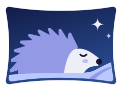
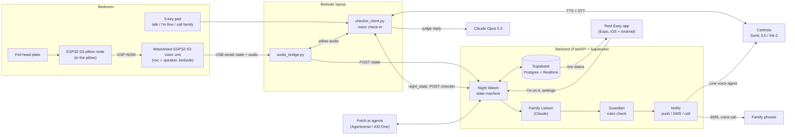
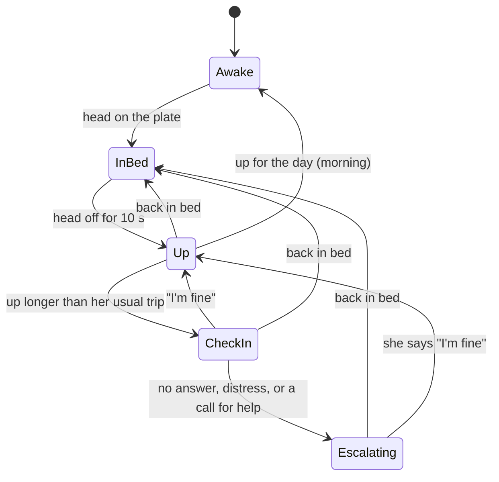
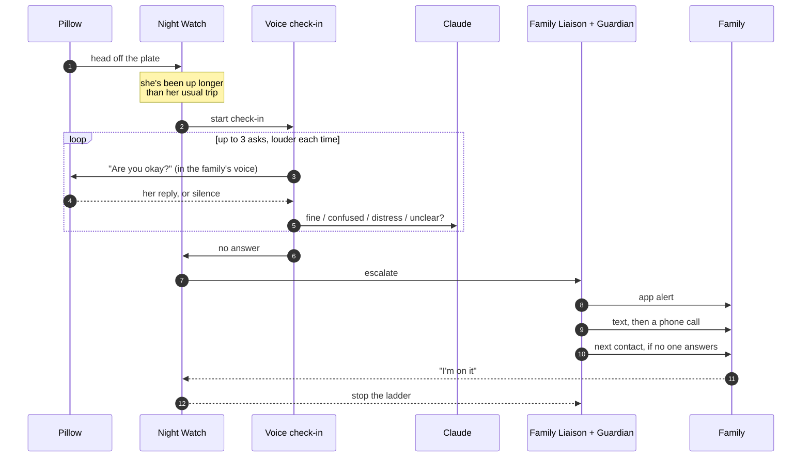

<p align="center">
  
</p>

<h1 align="center">Rest Easy</h1>

<p align="center"><b>Not a monitor. A goodnight.</b><br>
An agentic pillow that watches over an older parent at night, so the family can sleep too.</p>

<p align="center">Built in one weekend at <b>Cal Hacks 13.0</b> (San Francisco, October 2026).</p>

---

## Why

About a quarter of falls in older adults happen overnight, and two or more bathroom trips a night
more than double the risk of a fall or fracture (NIH StatPearls, *Nocturia*). The usual answer is a
medical alert pendant, but only 9% of people over 65 use one, and only 18% of those wear it all the
time (The Senior List, 2026).

Rest Easy is for an older adult who lives alone, isn't bedridden, and gets up in the night, and for
the adult child who worries about them. She wears nothing and needs no screen: **the pillow feels
her get up**. If she doesn't come back to bed, the pillow asks her, in a familiar voice, whether
she's okay. If she doesn't answer, or says she isn't, it tells her family, least intrusive first.
It never calls emergency services on its own.

## What it does

| | |
|---|---|
| **Feels the night** | A foil switch plate in the pillow knows when her head is on it. In bed, up, back again: no camera, no wearable, no raw audio stored. |
| **Checks in by voice** | When she's been up longer than her usual trip, the bedside speaker asks if she's okay, up to three times and louder each time. Claude judges each reply as *fine*, *confused*, *distress* or *unclear*. |
| **Escalates gently** | No answer, or a call for help, starts the family ladder: app alert, then a text, then a phone call, then the next person. "I'm on it" in the app stops it. Distress phones everyone at once. |
| **Learns her normal** | Week one uses a fixed 20 minute timeout. After that the timeout follows her usual trip length, and unusually long trips are called out in the family's night summary. |
| **Settles her back to sleep** | "I can't sleep" plays ten minutes of quiet music or rain through the pillow; a key, a check-in or getting up stops it. Reminders (meds, call family) play by voice and never advise on dosing. |
| **Speaks in a voice she knows** | Family record a short sample in the app; Cartesia clones it, so the pillow and the alert calls speak in the family's own voice. |
| **Talks to family agents** | Each family member has a Fetch.ai agent on Agentverse. Ask it in ASI:One "How was Mum's night?" or "I'm away Thursday to Sunday, make sure Mum's covered." |

The resident has **no app and no login**. She consents at setup and talks to the pillow, or uses
a three-key pad by the bed: *talk*, *I'm fine*, *call family*.

## How it works



**Plain code decides; the model talks.** Timers, thresholds and the escalation ladder are a
deterministic state machine (`backend/app/agents/night_watch.py`). Claude does language and
judgement only: understanding what she said, and wording each alert for its channel. Every
command, spoken line and alert passes the **Guardian** first, which enforces quiet-hour caps, a
maximum number of alerts per contact per night, no medical claims and no raw audio.

### Night Watch



After an "I'm fine" the pillow asks again later. If she says she's fine twice in one trip, family
get an informational heads-up rather than an alarm.

### A check-in that needs family



## Repository

| Path | What's there |
|---|---|
| `backend/` | FastAPI service: Night Watch, Guardian, Family Liaison, reminders, night summaries and baselines, notifications (Twilio, Cartesia Line), Supabase migrations and seed data. |
| `frontend/` | The Rest Easy family app (Expo SDK 58, React Native, Expo Router, NativeWind). |
| `voice/` | The bedside voice: check-in client, Cartesia speech in and out, the Claude reply judge, settle music, reminders, keypad. |
| `firmware/` | Arduino sketches for the ESP32-S3 pillow node and the Waveshare voice unit, plus diagnostics. Parts list in `firmware/PARTS.md`. |
| `sim/` | The laptop audio bridge, serial bridges, and simulators to run a night without hardware. |
| `agents/fetch/` | The Fetch.ai coordinator and family agents (uAgents, Agent Chat Protocol). |
| `deploy/` | Docker Compose, Cloudflare tunnel config and the deploy script. A merge to `master` deploys. |
| `coord/` | How four people and four Claude Code sessions built this together over a shared message bus. |
| `PRODUCT.md`, `DESIGN.md` | Who it's for, product principles, and the design system. |

## Running it

Backend (Python 3.12, [uv](https://docs.astral.sh/uv/)), with a Supabase project and the keys in
`backend/.env` (see `backend/README.md`):

```bash
cd backend
uv run uvicorn app.main:app --reload --port 8000
uv run pytest   # Supabase tests skip without SUPABASE_URL / SUPABASE_SECRET_KEY
```

A whole night without hardware:

```bash
uv run sim/night_watch_demo.py
```

The app:

```bash
cd frontend && npm install && npx expo start
```

The bedside voice and the pillow bridge: see `voice/` and `firmware/README.md`.

## Principles

1. **Least intrusive first.** App alert, then text, then call, then the next person. Never auto-call emergency services.
2. **Say only what matters.** Silence should mean a quiet night.
3. **Respect the resident.** Consent at setup, pause by voice, no raw audio, no medical claims.
4. **Readable at 2 am.** Her state is written in plain words ("Mum is asleep"), never colour alone.
5. **The pillow does the work.** She never needs a screen.

Rest Easy is a hackathon prototype. It is not a medical device, has not been clinically validated,
and should not replace emergency services or professional care.

## Team

Built at Cal Hacks 13.0 by Keanu Czirjak (hardware and firmware), Adam Kassam (agents and voice),
Szymon Arciszewski (backend, notifications and the app) and Adyan Ullah (pillow node and settle),
each working alongside their own Claude Code session.
