<p align="center">
  
</p>

<h1 align="center">Rest Easy</h1>

<p align="center"><b>Not a monitor. A goodnight.</b><br>
A pillow that notices when an older parent gets up in the night and doesn't come back, asks if
they're okay, and tells the family if they aren't.</p>

<p align="center">Built in one weekend at <b>Cal Hacks 13.0</b> in San Francisco, October 2026.</p>

<p align="center">
  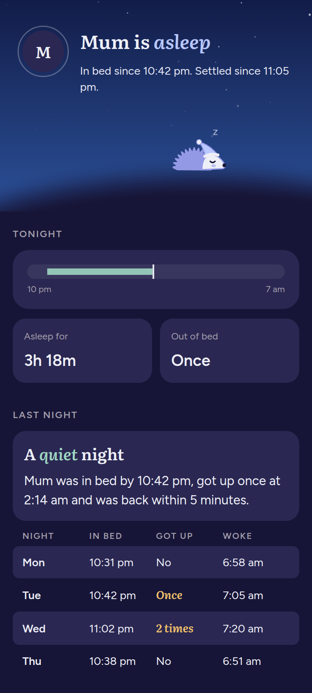
  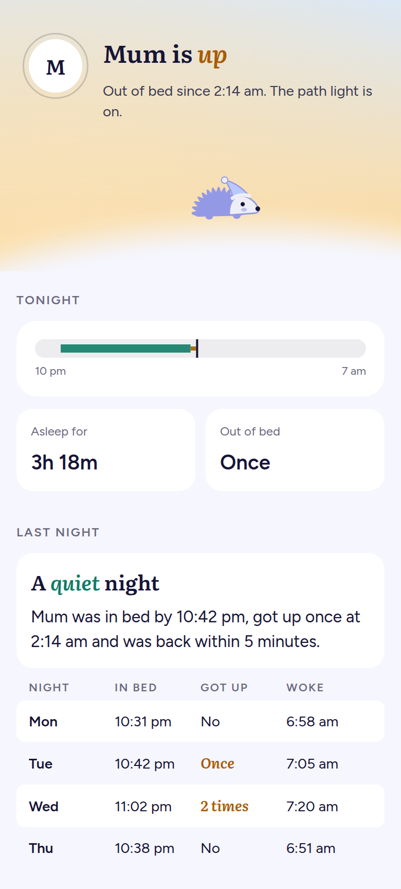
  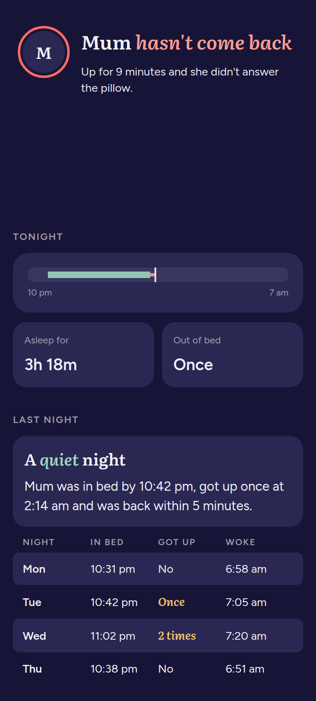
</p>

---

## Why we built it

About a quarter of falls in older adults happen at night, and people who get up to use the
bathroom two or more times a night have more than double the risk of a fall or fracture (NIH
StatPearls, *Nocturia*). The usual fix is a medical alert pendant. Only 9% of people over 65 use
one, and only 18% of those wear it all the time (The Senior List, 2026). A pendant on the bedside
table doesn't help anyone.

So we started from the thing everyone already uses every night. Rest Easy is for an older adult
who lives alone, isn't bedridden and gets up in the night, and for the son or daughter who lies
awake wondering whether she's alright. She doesn't wear anything or look at a screen. The pillow
knows when her head is on it. If she gets up and is gone for longer than her usual trip, the pillow
asks her, in a voice she knows, whether she's okay. If she doesn't answer, or says she needs help,
it tells her family, starting with the gentlest option. It never calls emergency services by
itself.

## What it does

**It feels when she's in bed.** Inside the pillowcase there's a plate made of two sheets of
kitchen foil on cardboard. When her head presses down, the sheets touch and pull a pin on the
ESP32-S3 low. That's all the sensing there is: no camera, nothing to wear, and no audio is ever
stored.

<p align="center">
  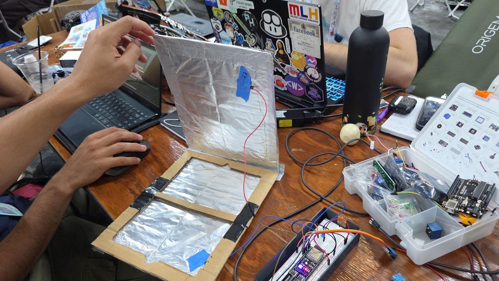
  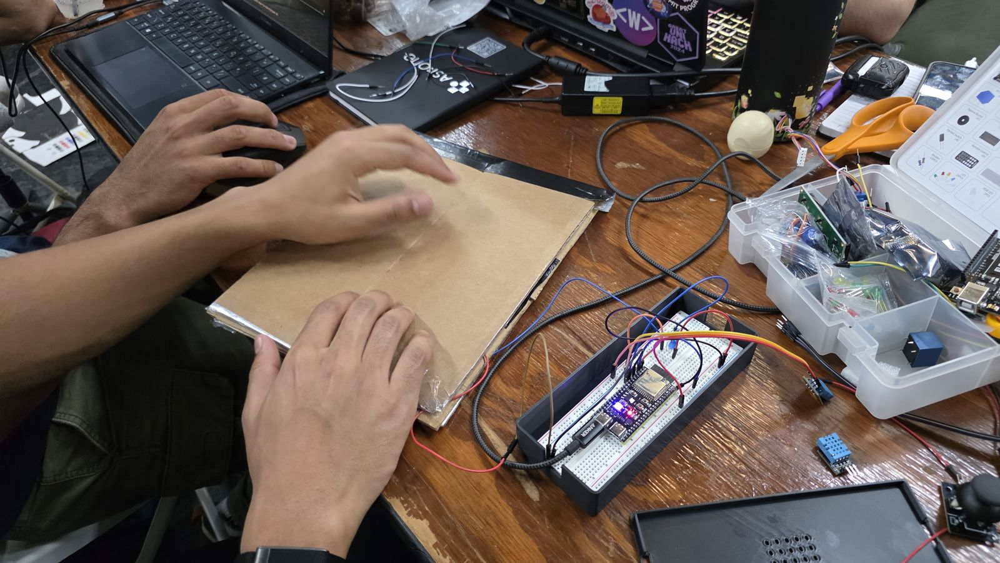
</p>

**It checks in by voice.** Once she's been up longer than her usual trip, the bedside speaker asks
whether she's okay. It tries up to three times, a little louder each time. Claude reads each reply
and sorts it into *fine*, *confused*, *distress* or *unclear*.

**It tells the family, gently first.** Silence or a call for help starts a ladder: an alert in the
app, then a text, then a phone call, then the next person on the list. Tapping "I'm on it" in the
app stops it. If she sounds distressed, everyone gets a call straight away.

<p align="center">
  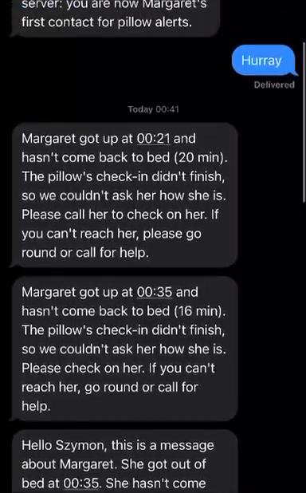
  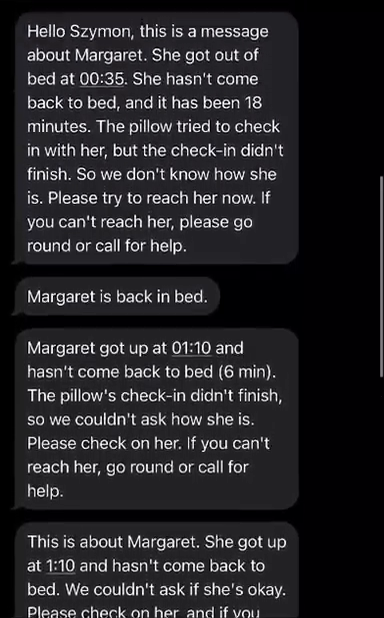
</p>

These are the texts that reached a family member's phone during our test runs early on Sunday
morning. Each one says when she got up, how long she's been gone and whether the check-in
finished. When she gets back into bed, a short "Margaret is back in bed" follows. We cropped the
sender's number off the top.

**It learns her normal.** For the first week it waits a fixed 20 minutes. After that, the timeout
follows how long her trips usually take, and the family's night summary points out any trip that
ran much longer than usual.

**It helps her get back to sleep.** If she says "I can't sleep", the pillow plays ten minutes of
quiet music or rain. A key press, a check-in or getting up stops it. It also reads out reminders
like "take your tablets" or "call your daughter", but it never gives advice about doses.

**It speaks in a family voice.** Someone in the family records a short sample in the app.
Cartesia clones it, so the check-ins and the alert phone calls sound like her own family rather
than a stranger.

<p align="center">
  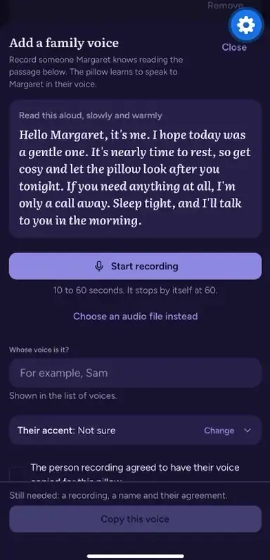
</p>

Recording a family voice in the app. It shows a short passage to read aloud and counts the
seconds; this take stopped at 14.

**Family can ask an agent about her night.** Each family member gets a Fetch.ai agent on
Agentverse. In ASI:One they can ask "How was Mum's night?" or tell it "I'm away Thursday to
Sunday, make sure Mum's covered."

The resident herself never needs an app or a login. She agrees to it at setup, and after that she
either talks to the pillow or uses a small three-key pad by the bed with *talk*, *I'm fine* and
*call family*.

## The app

The family app is built with Expo and runs on iOS and Android. Its main screen says what's
happening in plain words ("Mum is asleep", "Mum hasn't come back") and doesn't rely on colour
alone, because it's meant to be read half awake at 2 am. Below that is a ribbon showing the night
so far and a short summary of last night. It opens in dark mode by default, and light mode is a
setting.

<p align="center">
  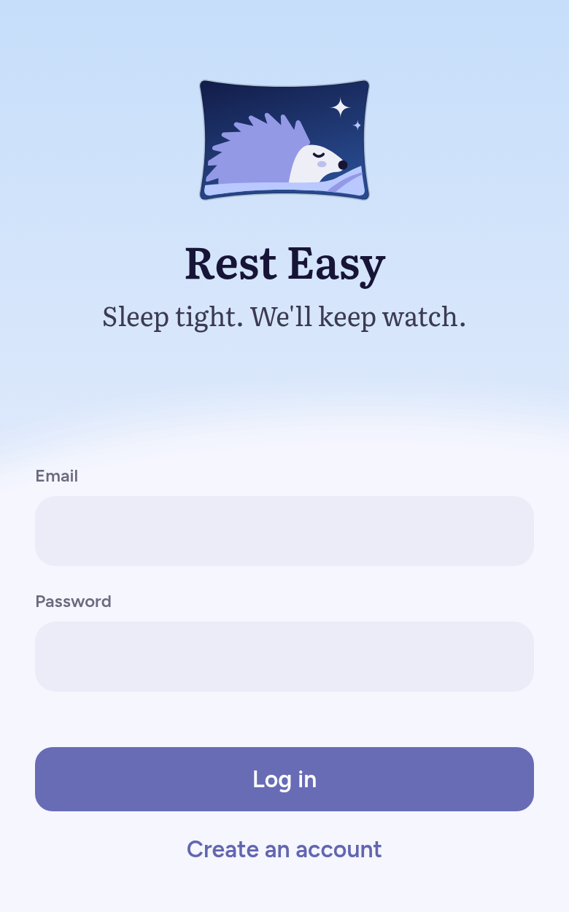
</p>

The screenshots on this page come from the app running in a browser with sample data for one
night, so the times in them are made up.

The three clips below are screen recordings from an iPhone running the app on Sunday morning,
sped up and trimmed. The resident in them is called Margaret.

<p align="center">
  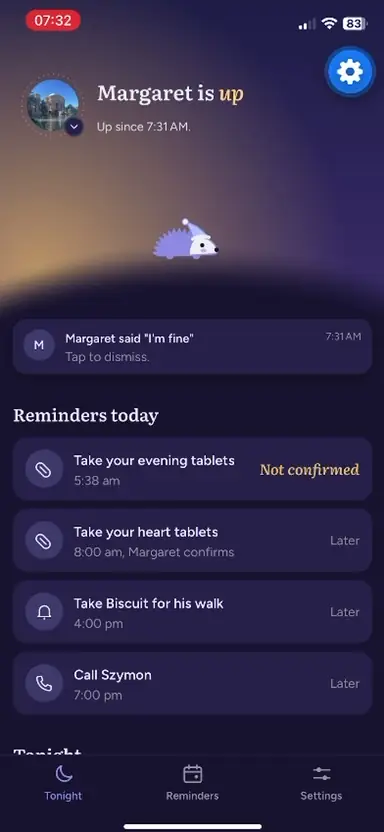
  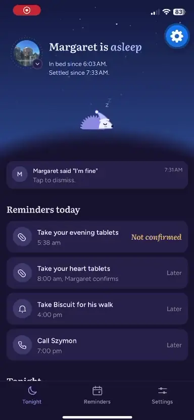
  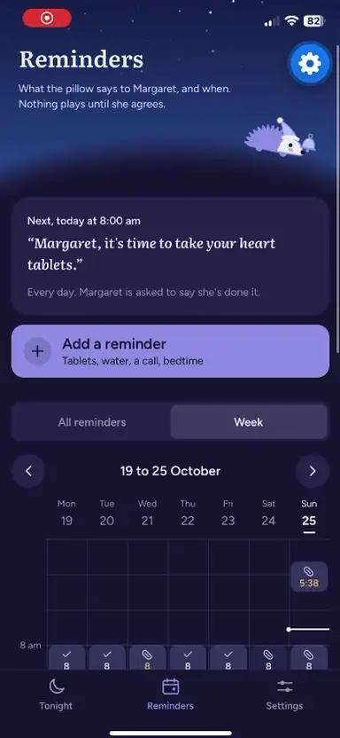
</p>

On the left, the Tonight screen changes as her state does: up, asleep, restless, asleep, then up
again with "The pillow is checking in" under her name. In the middle is the rest of that
screen, from the alert card down through temperature, movement and the log of everything the
pillow noticed overnight. On the right, a family member adds a water reminder. Before it starts,
the pillow asks Margaret whether that's alright.

## How it works

<picture>
  <source media="(prefers-color-scheme: dark)" srcset="docs/images/diagrams/system-flow-dark.png">
  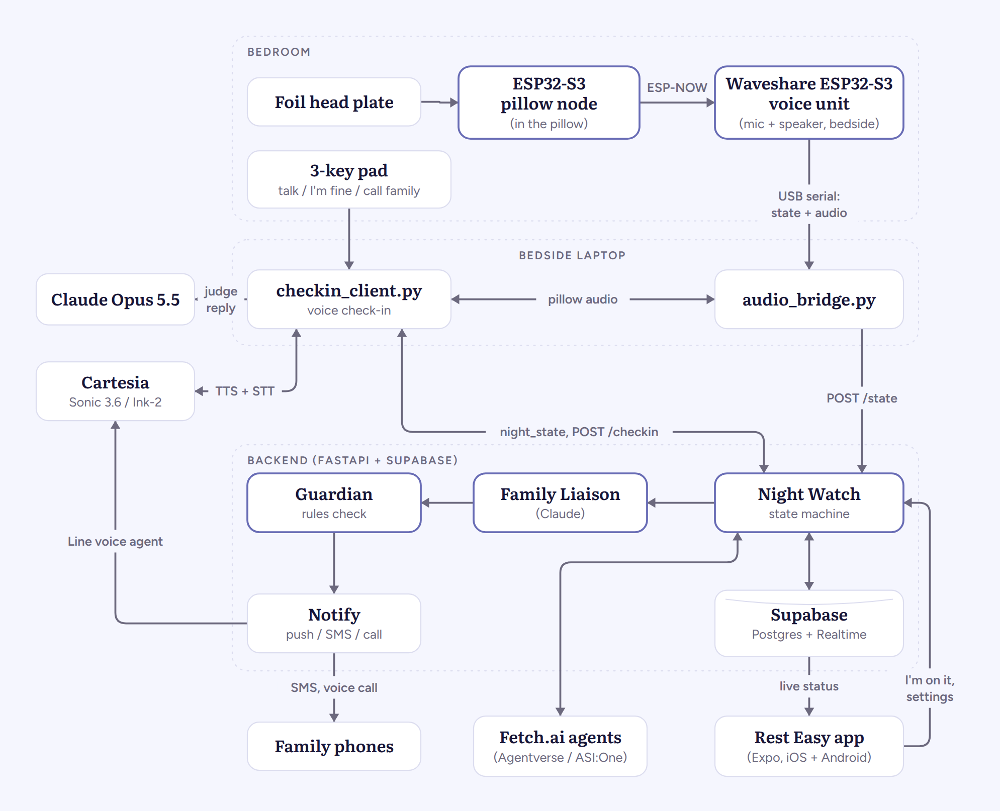
</picture>

<details>
<summary>Mermaid source for the system diagram</summary>

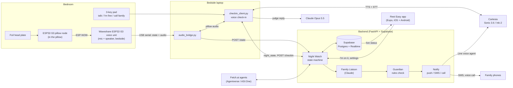

</details>

The pillow node sends its state over ESP-NOW to the voice unit by the bed, which passes it to a
laptop over USB. The laptop forwards state changes to the backend and runs the voice check-in.

We kept the decisions out of the language model on purpose. The timers, thresholds and the
escalation ladder are ordinary code in a state machine (`backend/app/agents/night_watch.py`), so
the same night always produces the same alerts. Claude is used for two jobs: working out what she
said, and writing each alert so it reads well as a push notification, a text or a phone call.
Everything the system is about to say or send goes through a rules check we call the Guardian
first. It limits alerts during quiet hours, caps how many alerts one person can get in a night,
and blocks medical claims and raw audio.

### Night Watch

<picture>
  <source media="(prefers-color-scheme: dark)" srcset="docs/images/diagrams/night-watch-dark.png">
  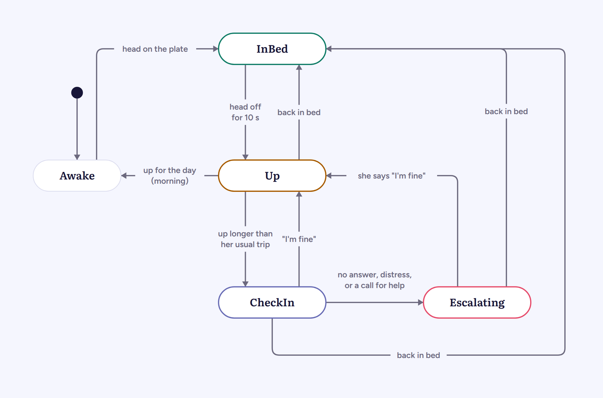
</picture>

<details>
<summary>Mermaid source for the state diagram</summary>

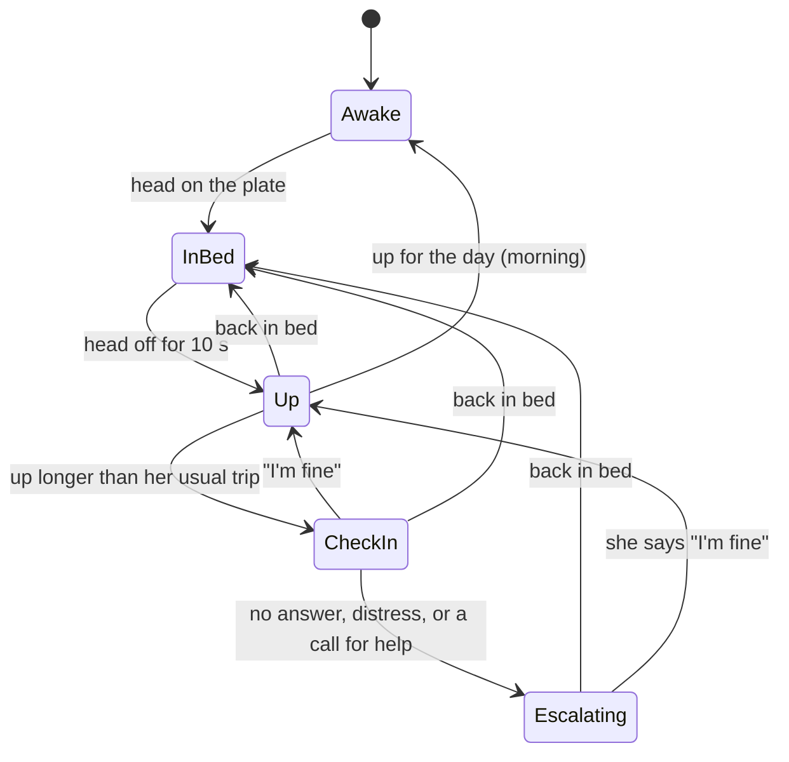

</details>

When she says she's fine, the pillow believes her but asks again a bit later. If she says "I'm
fine" twice during the same trip, the family get a heads-up for information, not an alarm.

### A check-in that needs family

<picture>
  <source media="(prefers-color-scheme: dark)" srcset="docs/images/diagrams/checkin-sequence-dark.png">
  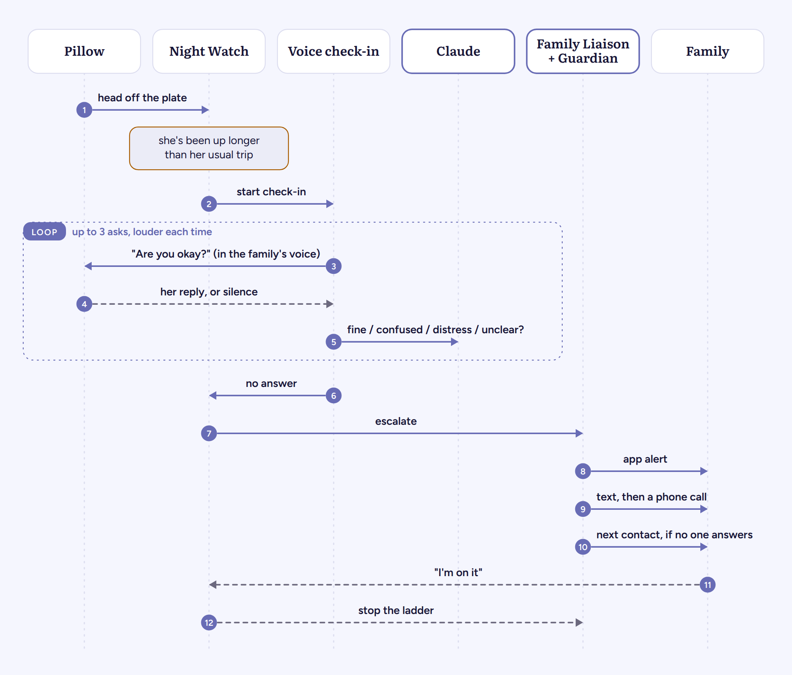
</picture>

<details>
<summary>Mermaid source for the sequence diagram</summary>

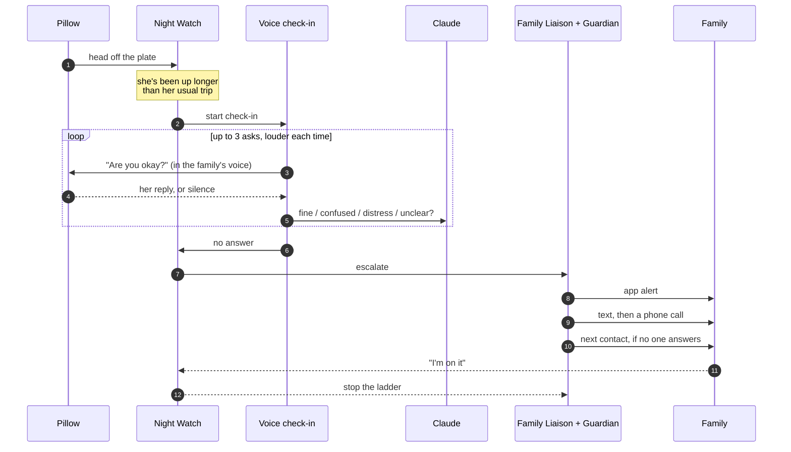

</details>

## Building it

<p align="center">
  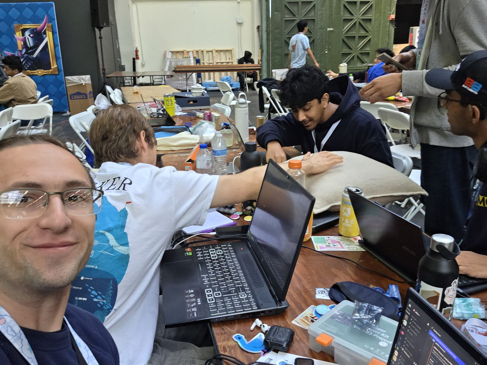
  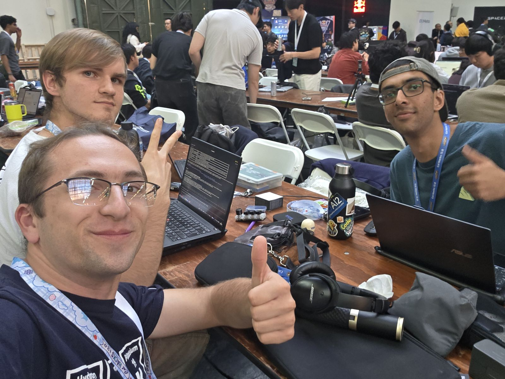
</p>

There were four of us, and each person worked with their own Claude Code session. The four
sessions talked to each other over a small message bus we wrote for the weekend, so one person's
Claude could ask another's about an API change without either of us relaying it by hand.
`coord/` has the protocol and a few screenshots of it in use.

<p align="center">
  <a href="docs/images/build-overnight-timelapse.mp4">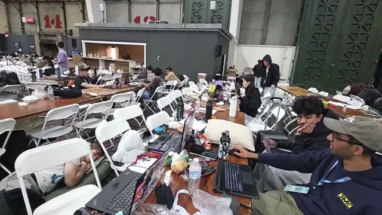</a>
</p>

A timelapse from our table, starting around 4:30 am on Sunday. The pillow sits between the
laptops. Click it for a sharper mp4 version.

## Repository

| Path | What's there |
|---|---|
| `backend/` | The FastAPI service: Night Watch, the Guardian, the Family Liaison, reminders, night summaries and baselines, notifications (Twilio and Cartesia Line), and the Supabase migrations and seed data. |
| `frontend/` | The Rest Easy family app (Expo SDK 58, React Native, Expo Router, NativeWind). |
| `voice/` | Everything the bedside speaker does: the check-in client, Cartesia speech in and out, the Claude reply judge, settle music, reminders and the keypad. |
| `firmware/` | Arduino sketches for the ESP32-S3 pillow node and the Waveshare voice unit, plus diagnostics. The parts list is in `firmware/PARTS.md`. |
| `sim/` | The laptop audio bridge, serial bridges, and simulators that run a whole night without any hardware. |
| `agents/fetch/` | The Fetch.ai coordinator and family agents (uAgents, Agent Chat Protocol). |
| `deploy/` | Docker Compose, the Cloudflare tunnel config and the deploy script. Merging to `master` deploys. |
| `coord/` | The message bus and protocol the four Claude Code sessions used. |
| `docs/images/` | The screenshots and photos in this README. |
| `PRODUCT.md`, `DESIGN.md` | Who it's for, the product principles, and the design system. |

## Running it

The backend needs Python 3.12, [uv](https://docs.astral.sh/uv/), a Supabase project, and its keys
in `backend/.env` (`backend/README.md` lists them):

```bash
cd backend
uv run uvicorn app.main:app --reload --port 8000
uv run pytest   # Supabase tests skip without SUPABASE_URL / SUPABASE_SECRET_KEY
```

To play through a whole night without the hardware:

```bash
uv run sim/night_watch_demo.py
```

To run the app:

```bash
cd frontend && npm install && npx expo start
```

Setting up the bedside voice and the pillow bridge is covered in `voice/` and `firmware/README.md`.

## Principles

1. **Least intrusive first.** An app alert comes before a text, a text before a call, and a call
   before the next person. It never calls emergency services by itself.
2. **Only say what matters.** If the family hear nothing, it should mean she had a quiet night.
3. **Respect the resident.** She consents at setup and can pause it by voice. No raw audio is
   kept, and it makes no medical claims.
4. **Readable at 2 am.** Her state is always written out in words ("Mum is asleep"), not shown by
   colour alone.
5. **The pillow does the work.** She never has to look at a screen.

Rest Easy is a hackathon prototype. It isn't a medical device, it hasn't been clinically tested,
and it shouldn't replace emergency services or professional care.

## Team

Built at Cal Hacks 13.0 by Keanu Czirjak (hardware and firmware), Adam Kassam (agents and voice),
Szymon Arciszewski (backend, notifications and the app) and Adyan Ullah (hardware + video).
